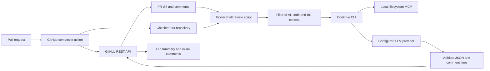

# Digia Business Central AI Reviewer: Architecture, Security, and CI/CD Guidance

## What This Project Does

This repository provides a composite GitHub Action for AI-assisted Business Central AL pull-request reviews. It does not compile AL code or execute BC analyzers. It sends selected source code and metadata to an LLM and asks the model to emulate a senior BC reviewer.



### Runtime Flow

1. GitHub creates a temporary hosted runner for the job.
2. The workflow checks out the repository into `GITHUB_WORKSPACE`.
3. [`action.yml`](action.yml) installs Node 24 and lockfile-pinned dependencies with `npm ci`.
4. Continue starts the local filesystem MCP server inside that runner when needed.
5. The supplied `MODELS_BLOCK` is merged with [`.github/actions/continue/default-config.yaml`](.github/actions/continue/default-config.yaml).
6. [`scripts/continue-review.ps1`](scripts/continue-review.ps1) retrieves the PR diff using the GitHub API.
7. Changed files are filtered using workflow patterns and built-in sensitive-path rules.
8. The script adds:
   - Changed AL lines with surrounding context.
   - Relevant `app.json` files.
   - Permission sets, entitlements, and Markdown.
   - Parsed AL object metadata.
   - Up to 200 existing review comments.
9. Continue sends the prompt only to a hostname permitted by `ALLOWED_PROVIDER_HOSTS`.
10. The response is parsed and constrained to valid changed lines.
11. A summary and inline comments are posted through the GitHub API.
12. Temporary files are deleted, and the hosted runner is discarded after the job.

Business Central itself is not installed by this action. AL compilation, analyzers, and tests must run in separate CI steps.

The BC specialization mainly comes from [`.continue/prompts/review-pr.md`](.continue/prompts/review-pr.md) and [`.continue/rules/pr-reviewer.md`](.continue/rules/pr-reviewer.md): posting, ledgers, VAT, dimensions, permissions, upgrade safety, SaaS considerations, analyzers, and AL patterns.

## What Leaves GitHub

The provider receives more than the raw diff:

- Changed AL code with 12 context lines by default.
- Up to 30 context files by default.
- At most 200,000 UTF-8 bytes per file or changed-file context by default.
- At most 4,000,000 UTF-8 bytes for the complete prompt by default.
- Complete relevant permission and entitlement files.
- Relevant Markdown and `app.json`.
- BC object metadata.
- Previous review comments.
- Up to three selective, read-only filesystem MCP calls when additional repository context is needed.

Built-in filtering blocks common secret, credential, generated-output, translation, test-data, customer-export, archive, certificate, and key paths. These controls reduce accidental disclosure but do not replace secret scanning and repository data-classification rules.

Therefore, customer business logic is transmitted outside the GitHub runner to the configured LLM endpoint. Repository scoping does not prevent that transmission. It only limits which files MCP can access.

The generated review can also contain customer logic and is stored in the PR and potentially in Actions logs.

## MCP In This Project

MCP, Model Context Protocol, is a standard way for an AI application to discover and call tools.

Here:

- Continue CLI is the MCP host/client.
- `@modelcontextprotocol/server-filesystem` is a local MCP server.
- It is installed from the pinned npm dependency tree during the Actions job.
- It runs as a child process inside the temporary runner over standard input/output.
- It is launched with `--read-only --confine-roots`.
- It can read only within the checked-out `GITHUB_WORKSPACE`.
- Results from filesystem calls are returned to Continue and may then be included in requests to the LLM.
- It disappears when the temporary runner is discarded.

MCP is not itself an LLM or a hosted storage service. It is an access protocol. Its security depends on the server, tools, permissions, client behavior, and provider.

## Current MCP Configuration

The current implementation enforces the intended MCP boundary:

- The filesystem MCP process runs locally on the Actions runner.
- It is not Digia-hosted.
- It is technically read-only.
- Its command-line root is confined to `GITHUB_WORKSPACE`.
- GitHub MCP and Microsoft Learn MCP are not configured.
- Terminal context has been removed.

Implemented configuration:

```yaml
mcpServers: [{ name: "filesystem", command: "npx", args: ["--prefix", "{{GITHUB_ACTION_PATH}}", "--no-install", "mcp-server-filesystem", "--read-only", "--confine-roots", "{{GITHUB_WORKSPACE}}"] }]
```

## Is It Safe?

The fork now includes technical hardening for the main repository-level risks, but organizational approval must still cover the provider contract, customer authorization, data classification, residency, networking, retention, and human governance.

Main risks:

- Customer code is deliberately sent to an external processor.
- `DEBUG_PAYLOAD=true` can still print source payloads into Actions logs and must remain disabled for customer code.
- PR code and descriptions are untrusted input and can contain prompt-injection instructions.
- Provider and GitHub processing remain external processing of customer intellectual property.
- Runner-level network egress cannot be enforced by this action alone.

Implemented controls include lockfile-pinned npm dependencies, Node 24, immutable external Action SHAs, read-only and confined filesystem MCP, removal of terminal context, trusted `/review` associations, standalone command validation, sensitive-path filtering, payload/file/count limits, mandatory exact provider-host allowlisting, non-verbose model execution, temporary-file cleanup, environment-safe action input handling, and enforced human-only approval decisions.

## Implementation Status

| # | Recommendation | Status | Current implementation / remaining action |
|---:|---|---|---|
| 1 | Fork or mirror the action and pin it by full SHA | Partly complete | This repository is the internal fork, and external Actions are pinned by SHA. After these changes are committed, consuming repositories must reference this fork using that new full commit SHA. |
| 2 | Pin npm packages and maintain a lockfile | Implemented, pending commit | Exact direct versions are declared in [`package.json`](package.json); [`package-lock.json`](package-lock.json) records the complete dependency tree and integrity hashes; the action uses `npm ci`. Both manifests must be included in the hardening commit. |
| 3 | Enforce read-only, confined filesystem MCP | Implemented | Filesystem MCP uses `--read-only --confine-roots` and `GITHUB_WORKSPACE`. GitHub and Microsoft Learn MCP servers are disabled. |
| 4 | Use approved regional Azure OpenAI and private networking | Partly complete | `ALLOWED_PROVIDER_HOSTS` is mandatory and validates the explicit HTTPS endpoint. Azure region, private endpoint, DNS, firewall, and runner routing must be configured in Azure/company infrastructure. |
| 5 | Disable payload debugging and review verbose logging | Implemented by default | `DEBUG_PAYLOAD` defaults to false. Continue `--verbose` and raw failure output were removed. Production policy must prevent callers from enabling debug for customer code. |
| 6 | Restrict context and exclude sensitive files | Implemented, review required | Built-in path filtering blocks common sensitive/generated/export formats, and include/exclude inputs remain available. Each customer repository should still define project-specific exclusions. |
| 7 | Restrict `/review` to trusted members | Implemented | Only configured trusted GitHub author associations are accepted, and `/review` must be a standalone command. The sample workflow also filters associations. |
| 8 | Keep AI review advisory and require humans | Implemented | `APPROVE_REVIEWS=true` is rejected by the composite action. The AI posts comments only; branch protection and required reviewers remain organization settings. |
| 9 | Add payload and per-file limits | Implemented | Defaults: 200 KB per file/context, 4 MB total prompt, and 30 context files. Oversized changed-file context or prompts fail closed. |
| 10 | Clean temporary files and restrict provider egress | Partly complete | Temporary files are removed in `finally`; exact provider host validation is mandatory. Network-level egress enforcement must be implemented on the runner/firewall/proxy. |
| 11 | Treat repository content as hostile input | Implemented with residual LLM risk | Prompts classify repository content as untrusted, forbid secret access and file mutation, and MCP is technically read-only. Prompt injection cannot be eliminated completely, so output remains advisory. |
| 12 | Pilot with synthetic/non-customer code | Not yet completed | Run and document a controlled pilot before enabling customer repositories. Include security, quality, cost, failure, and data-flow acceptance criteria. |

## Provider And Regulation

The action supports arbitrary providers, so the repository itself cannot guarantee data residency, retention, GDPR compliance, or that data is excluded from training.

For confidential customer code, Azure OpenAI/Foundry under the company's tenant is generally the clearest option. Microsoft states that Azure-hosted prompts and completions:

- Are not available to OpenAI.
- Are not used to train foundation models without permission.
- Are processed according to the selected deployment geography, except Global/DataZone deployments.
- May be retained or reviewed for abuse monitoring in some configurations.
- Can be stored when using stateful features such as Responses API history.

The README example uses the Responses API. Confirm whether storage is enabled and configure deletion and retention accordingly.

Legal, privacy, and compliance work still needed:

- A customer contract permitting this processing.
- Microsoft/provider DPA and subprocessor review.
- Data residency selection, preferably a regional EU deployment if required.
- GDPR/legal classification and potentially a DPIA.
- Confirmation that repositories contain no production data, credentials, PII, or customer datasets.
- An approved retention policy for provider data, PR comments, and Actions logs.

"Not used for training" does not mean "no processing or storage."

## Recommended CI/CD Integration

Run the AI review after AL build, CodeCop, AppSourceCop, tests, and secret scanning. Initially make it advisory only:

```text
Build/analyzers/tests -> secret scan -> AI review -> human approval -> merge
```

## Remaining Work Before Company Rollout

### Repository And Release

1. Review and commit the hardening branch.
2. Create an approved release/tag and record its full commit SHA.
3. Update consuming workflows to use the internal fork at that immutable SHA.
4. Add CODEOWNERS and change approval for the action, workflow, prompt, rules, and dependency files.
5. Configure Dependabot or an equivalent controlled process for npm and GitHub Action SHA updates.

### Azure And Network

1. Select an approved regional Azure OpenAI/Foundry deployment; avoid Global deployment where residency requirements prohibit it.
2. Confirm whether the selected API/model feature stores conversation state and configure retention/deletion.
3. Configure private endpoint, private DNS, and runner connectivity where practical.
4. Enforce network egress so the runner can reach only required setup services and the approved LLM endpoint. Consider an internal package mirror to reduce public npm access.
5. Prefer short-lived identity where supported; otherwise store and rotate the API key as a protected GitHub environment secret.

### GitHub Governance

1. Apply least-privilege workflow permissions: `contents: read` and `pull-requests: write` only where required.
2. Require human reviewers and branch protection independently of the AI result.
3. Protect production secrets with GitHub environments and required reviewers.
4. Define Actions-log retention and an incident procedure for deleting logs and rotating credentials after accidental disclosure.
5. Decide whether forked PRs are allowed; never expose protected secrets to untrusted fork code.

### Customer And Compliance

1. Obtain contractual permission to process customer source code with the selected provider.
2. Complete DPA, subprocessor, data-residency, GDPR, DPIA, and internal AI-governance reviews as applicable.
3. Classify repository content and verify that no production data, credentials, PII, or customer datasets are committed.
4. Define retention requirements for provider processing, GitHub review comments, and Actions logs.

### Pilot And Acceptance

1. Run the workflow first on synthetic or non-customer Business Central code.
2. Test normal PRs, oversized payloads, blocked paths, untrusted `/review` comments, malformed model output, and provider-host rejection.
3. Review false positives, false negatives, token cost, execution time, and whether comments expose unnecessary code.
4. Obtain security, legal, platform, and BC engineering approval before onboarding customer repositories.

The project is a useful BC review assistant, but it should be treated as a controlled disclosure pipeline to an AI processor, not as a purely local reviewer.

## Primary External References

- [Data, privacy, and security for Azure-hosted Foundry Models](https://learn.microsoft.com/en-us/azure/ai-foundry/responsible-ai/openai/data-privacy)
- [GitHub Actions secure use reference](https://docs.github.com/en/actions/security-for-github-actions/security-guides/security-hardening-for-github-actions)
- [Model Context Protocol architecture](https://modelcontextprotocol.io/docs/concepts/architecture)
- [MCP security best practices](https://modelcontextprotocol.io/specification/2025-06-18/basic/security_best_practices)
- [Filesystem MCP server](https://github.com/modelcontextprotocol/servers/tree/main/src/filesystem)